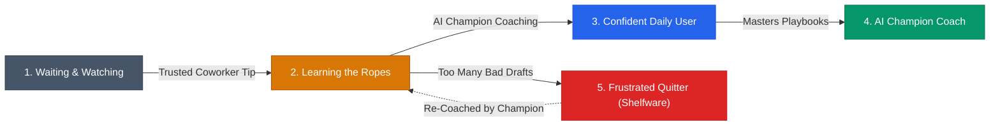

# Plain-English Guide: Team Behavior Simulation (Agent-Based Modeling)

> **Executive Summary:** People do not adopt new tools because of an executive memo—they adopt when a trusted coworker shows them a time-saving trick, and they quit if the tool keeps making frustrating mistakes.

---

## 1. What Is It in Plain English?

Think about how a new restaurant or phone app becomes popular. People try it when the person sitting next to them says, *"You have to see how much time this just saved me."*

In a **Team Behavior Simulation (Agent-Based Modeling)**, we do not treat your company as one giant spreadsheet line. Instead, we create **325 individual virtual employees** inside the computer—each with their own department, daily habits, and close coworkers.

---

## 2. The 5 Everyday Employee Habit Stages

| Stage | Employee Mindset | Monthly Impact on the Business |
| :--- | :--- | :--- |
| **1. Waiting & Watching** | Hasn't tried the tool yet; watching teammates first | `$0` license cost, `0` hours saved |
| **2. Learning the Ropes** | Trying AI out; working slightly slower during the early learning dip | Pays monthly seat fee; needs coaching to avoid frustration |
| **3. Confident Daily User** | Uses AI every day, checks facts carefully, and saves real time | Generates steady monthly time savings and net profit |
| **4. AI Champion** | Power user (`1.28x` speed gain) who coaches nearby coworkers | Helps *Learning* teammates succeed twice as fast |
| **5. Frustrated Quitter** | Gave up after too many bad AI drafts; seat becomes **Shelfware** | Company still pays for unused licenses until re-coached |

---

## 3. Three Practical Takeaways for Leaders

1. **Word-of-Mouth Spreads Faster Than Mandates:** Skeptical employees start trying AI when their immediate teammates use it successfully.
2. **AI Champions Are the Spark:** Training a small group of enthusiastic **AI Champions** (even `5%` to `8%` of each team) gives coworkers someone to ask for help, cutting early frustration in half.
3. **The "Shelfware" Trap:** If leaders hand out AI licenses to everyone on Day 1 without coaching (*Fast All-At-Once Push*), employees run into AI mistakes, get frustrated fixing bad drafts, and quietly stop using the tool—while the company keeps paying their monthly subscription fee!

```text
Waiting & Watching ──(Coworker Tip)──► Learning the Ropes ──(Champion Coaching)──► Confident Daily User ──► AI Champion
                                               │
                                    (Unchecked AI Mistakes)
                                               ▼
                                  Frustrated Quitter (Shelfware)
```

---

## 4. How Habits Spread Across Your Teams



---

## 5. Why People—Not Software—Decide Your Return

Buying 325 software licenses does not guarantee 325 daily users. In most companies, an all-staff announcement creates a brief spike of curiosity, followed by quiet drop-off if employees hit frustrating errors in their first week. Once someone gives up, their license becomes **Shelfware**—a monthly bill that delivers zero value.

The smartest way to protect your investment is to invest in people first. Training a small group of **AI Champions** inside each department gives hesitant coworkers a friendly desk neighbor to ask for help. That simple human support network turns early frustration into lasting daily habits.

- **Source File:** [`AgentBasedModel.jl`](src/simulations/agent-based/AgentBasedModel.jl)
