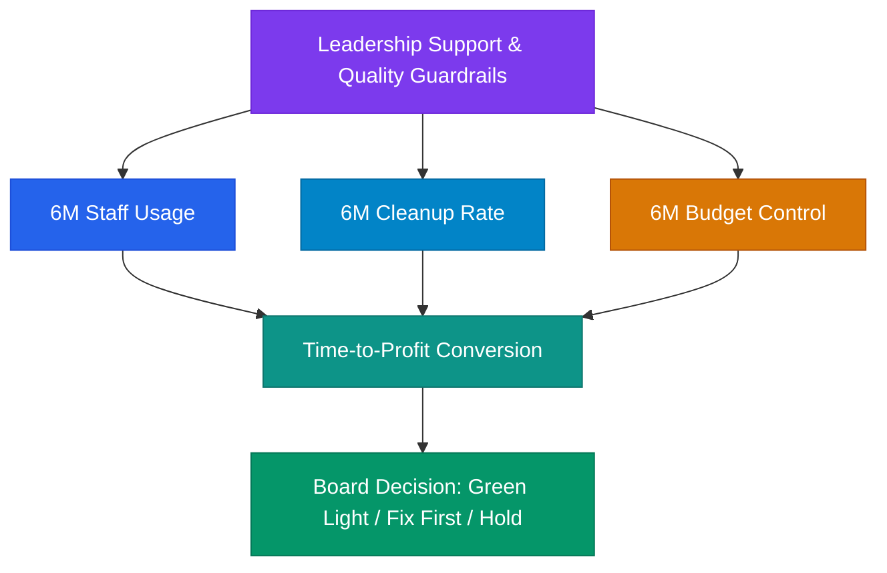

# Plain-English Guide: Pilot Scorecard Updater (Bayesian Networks)

> **Executive Summary:** Wise Boards never write a blank check on Day 1. They fund a **6-month pilot**, check three simple pilot signals (Usage, Cleanup Rate, and Budget Control), and update their 3-year profit odds before releasing next-stage funding.

---

## 1. Everyday Analogy: How a Doctor Updates a Diagnosis

Think about how a family doctor works:
- Before running any tests, the doctor starts with a reasonable **Day-1 Starting Estimate (`Prior`)** based on your age and symptoms.
- Once your **lab test results** come back, the doctor updates the diagnosis right away (**Updated Forecast / `Posterior`**) and recommends the next step.

A **Pilot Scorecard Updater (Bayesian Network)** does the exact same thing for your AI investment.

---

## 2. The 6-Month Pilot Checkpoint Map

```text
[Leadership Support] & [Quality Guardrails]   (Layer 1: Company Foundation)
                 │
                 ▼
[6M Staff Usage] • [6M Cleanup Rate] • [6M Budget Control]   (Layer 2: 6-Month Pilot Scorecard)
                 │
                 ▼
      [Time-to-Profit Conversion]             (Layer 3: Turning Saved Hours into Value)
                 │
                 ▼
   [Updated 3-Year Return & Funding Call]     (Layer 4: Green Light / Fix First / Hold)
```

---

## 3. How 6-Month Pilot Results Change Your Funding Call

| 6-Month Pilot Scorecard | Staff Usage | Cleanup Rate | Budget Control | Updated 3-Year Return | Board Stage-Gate Call |
| :--- | :--- | :--- | :--- | :--- | :--- |
| **Great 6-Month Pilot** | High (`>75%`) | Clean (`<5%`) | On Budget | **`+170%` to `+200%`** | **GREEN LIGHT** (Release Next-Stage Funding) |
| **Average 6-Month Pilot** | On Target (`45–75%`) | Moderate (`5–10%`) | On Budget | **`+65%` to `+115%`** | **FIX FIRST** (Tighten Quality Before Scaling) |
| **Busy But Messy Pilot** | High (`>75%`) | Heavy (`>10%`) | Over Budget | **`+15%` to `+45%`** | **FIX FIRST / HOLD** (Stop Bill Creep & Rework) |
| **Struggling Pilot** | Low (`<45%`) | Heavy (`>10%`) | Over Budget | **`-10%` to `+10%`** | **HOLD / PAUSE** (Freeze New Seats & Redesign) |

---

## 4. From 6-Month Pilot to Board Funding Call (Visual Map)



---

## 5. How Stage-Gate Funding Protects Company Capital

The biggest financial mistake in enterprise technology is committing a full 3-year budget before testing whether teams actually use the tool. A **Pilot Scorecard Updater** gives the Board a clear, disciplined alternative: fund a focused **6-month pilot** first, then let real numbers—not vendor promises—decide what happens next.

If staff usage is high, cleanup is low, and usage bills stay on budget, you get an objective **Green Light** to scale company-wide. If cleanup or bills are creeping up, you get an early **Fix First** warning while the financial commitment is still small.

- **Source File:** [`BayesianNetworkModel.jl`](src/simulations/bayesian-network/BayesianNetworkModel.jl)
