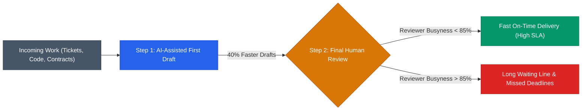

# Plain-English Guide: Workflow Waiting Lines (Discrete Event Simulation)

> **Executive Summary:** Speeding up first drafts by 40% will not speed up customer delivery if all those extra drafts get stuck waiting in line for **Final Human Review & Sign-Off**.

---

## 1. Everyday Analogy: The Airport Security Line

Picture an airport security checkpoint with three steps:
1. **Step 1 (Automated Triage):** A kiosk scans your boarding pass.
2. **Step 2 (First Draft / Execution):** You put your bag through the X-ray scanner.
3. **Step 3 (Final Human Review):** If anything looks unusual, an officer inspects your bag by hand.

Now suppose the airport buys a faster X-ray machine that speeds up **Step 2 by 40%**, *and* triggers a few more bag checks—without adding any extra officers at **Step 3**. What happens? **The final inspection line backs up, and travelers still miss their flights!**

---

## 2. How Work Flows Through Your 4 Departments

| Department | Everyday Work Item | Normal Turnaround | Where Waiting Lines Form |
| :--- | :--- | :--- | :--- |
| **Software Engineering** | Code Changes & Pull Requests | `~11–14 hrs` | Senior engineers reviewing AI-written code |
| **Customer Support** | Complex Escalation Tickets | `~2–3 hrs` | Team leads checking tricky customer replies |
| **Sales & Marketing** | Custom Deal Proposals & RFPs | `~8–10 hrs` | Pricing & compliance sign-off on proposals |
| **Legal & Finance** | Contract Redlines & Audits | `~10–13 hrs` | Senior counsel verifying legal clauses |

---

## 3. The 85% Busyness Danger Line

In waiting-line math, once the senior staff who review and approve work are busy more than **85% of the workday**, waiting lines grow dramatically:

```text
Reviewer Busyness:   50% ────► 70% ────► 85% (Danger Line!) ────► 95% (Multi-Day Backup!)
Wait Line Length:    Short     Moderate   Steep Climb             Severe Bottleneck
```

---

## 4. Where Everyday Work Gets Stuck (Visual Map)



---

## 5. Why Faster Drafts Alone Don't Equal Faster Delivery

Executives are often surprised when a team using AI writes proposals, code, or customer replies much faster—yet customers still wait just as long for the final result. The reason is simple: **a chain is only as fast as its slowest checkpoint.**

When AI floods senior reviewers with extra drafts, those reviewers quickly cross the **85% busyness danger line** and a waiting line forms. By shifting just **5% to 7%** of the time saved on drafting into extra final-review capacity, you clear the traffic jam, protect on-time delivery, and turn drafting speed into real business results.

- **How Smart Leaders Fix the Bottleneck:** In [`DiscreteEventModel.jl`](src/simulations/discrete-event/DiscreteEventModel.jl), our *Step-by-Step Phased Rollout* and *Full Workflow Redesign* plans shift **5% to 7% of saved drafting time into final quality review**, keeping waiting lines short and cutting total turnaround time by `25%` to `30%`.
