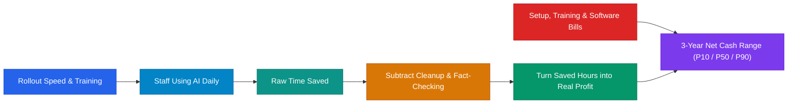

# Plain-English Guide: 10,000 What-If Futures (Monte Carlo Simulation)

> **Executive Summary:** Rather than betting your AI budget on a single optimistic spreadsheet number, **Monte Carlo Simulation** tests your business plan **10,000 times** with realistic ups and downs to give the Board an honest **Cautious (`P10`)**, **Typical (`P50`)**, and **Best-Case (`P90`)** range.

---

## 1. Everyday Analogy: Driving Across the State

Imagine you are driving across the state for an important dinner and someone asks: *"What time will you get here?"*

If you give **one optimistic number**—like *"6:00 PM sharp, assuming zero traffic, green lights, and clear skies"*—you will almost certainly be late. Instead, what if your GPS ran **10,000 practice drives** on a computer, testing realistic combinations of rain, roadwork, and rush-hour delays?

| Forecast Case | What It Means on the Road | What It Means for Your AI Budget |
| :--- | :--- | :--- |
| **Cautious Case (`P10`)** | 9 out of 10 trips arrive before **7:15 PM** | Your downside-protected floor (90% of simulated futures do better) |
| **Typical Case (`P50`)** | Half of trips arrive by **6:30 PM** | Your realistic middle outcome for base-case financial planning |
| **Best Case (`P90`)** | Top 1 out of 10 trips arrive by **6:05 PM** | Your upside potential when adoption is fast and cleanup work stays low |

---

## 2. Why Single-Number AI Pitch Decks Mislead Boards

Most AI proposals multiply three rosy guesses together:
1. *"Everyone will use the tool on Day 1..."*
2. *"...it will save 30% of their week..."*
3. *"...and every saved minute turns straight into profit."*

In real companies, four everyday realities get in the way:
- [x] **Gradual Adoption & Early Learning Dip:** Teams adopt tools step by step. In the first few months, people actually work a bit slower while learning new habits.
- [x] **Cleanup & Fact-Checking Time:** AI drafts emails, code, and reports quickly, but employees still have to check the facts and fix mistakes.
- [x] **Turning Saved Time into Real Money:** Saving someone 20 minutes a day only helps the bottom line if managers turn those saved hours into more finished work, faster customer replies, or lower outside contractor bills.
- [ ] **Unchecked Usage Bill Creep:** Without budget guardrails, monthly cloud bills can climb each quarter.

---

## 3. How the Model Calculates Each Trial

```text
Monthly Net Cash = (Active Staff × Raw Time Saved - Cleanup Time) × Profit Conversion
                   - (IT Setup + Training + Monthly Software & Usage Bills)
```

---

## 4. How Every Dollar Flows (Visual Map)



---

## 5. What This Means for Your Board Decision

When a vendor pitches a single return number—such as *"200% return in year one"*—they are usually showing you the best-case scenario where everything goes right on the first try. In reality, your company faces normal business friction: some teams need extra coaching, early drafts require careful fact-checking, and IT integration takes a few months.

Testing **10,000 What-If Futures** protects you from unpleasant budget surprises. Instead of hoping for the best, you can approve funding knowing that even in a **Cautious (`P10`)** year, your downside is protected—and if adoption goes smoothly, your **Typical (`P50`)** and **Best-Case (`P90`)** upside is clearly mapped out.

---

## 6. Quick Glossary (Under 60 Words Each)

- **Cautious (`P10`) / Typical (`P50`) / Best Case (`P90`):** Out of 10,000 simulated futures, `P10` is the cautious floor that 90% of futures beat, `P50` is the middle outcome, and `P90` is the top 10% upside.
- **Net Profit Today (`NPV`):** Total 3-year profit minus all setup, training, and software bills, adjusted so future dollars are worth slightly less than dollars today.
- **Source File:** [`MonteCarloModel.jl`](src/simulations/monte-carlo/MonteCarloModel.jl)
