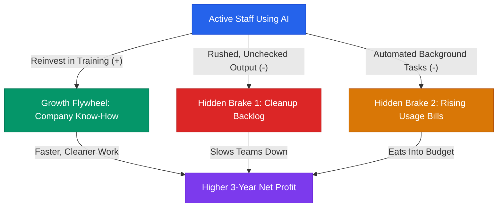

# Plain-English Guide: Long-Term Flywheels & Brakes (System Dynamics)

> **Executive Summary:** Over a 3-year horizon, your AI return is a tug-of-war between **Growth Flywheels** (shared playbooks and growing company know-how) and **Hidden Brakes** (sloppy cleanup backlogs and climbing monthly usage bills).

---

## 1. Everyday Analogy: Pushing a Snowball

Imagine pushing a snowball down a hill:
- As it rolls, it picks up more snow and builds momentum (**a Growth Flywheel**).
- At the same time, rough patches of grass and uphill slopes slow it down (**Hidden Brakes**).

**System Dynamics** tracks how these four big-picture forces interact month after month over 36 months.

---

## 2. The 2 Growth Flywheels vs. 2 Hidden Brakes

| Force | Type | How the Chain Reaction Works | 3-Year Impact |
| :--- | :--- | :--- | :--- |
| **Flywheel 1: Shared Tips** | `Growth Flywheel (+)` | More Active Users → Better Shared Templates → Easier for Next Wave | Speeds up adoption once `~25%` of staff are onboard |
| **Flywheel 2: Company Know-How** | `Growth Flywheel (+)` | Daily Practice + Training → Better Playbooks → Higher Speed & Fewer Errors | Multiplies output per person in Years 2 & 3 |
| **Brake 1: Cleanup Backlog** | `Hidden Brake (-)` | Rushed AI Output → Unchecked Mistakes Pile Up → Extra Time Fixing Bugs | Eats away saved hours if quality rules are weak |
| **Brake 2: Usage Bill Creep** | `Hidden Brake (-)` | Automated Background Tasks → More Cloud Calls per Seat → Rising Bills | Doubles or triples per-seat usage bills without guardrails |

---

## 3. How Reinvestment & Guardrails Tip the Balance

- [x] **Reinvest a Slice of Early Savings:** Putting `20%–35%` of early gains into role-specific playbooks keeps **Flywheel 2** spinning faster than **Brake 1**.
- [x] **Set Automated Budget Guardrails:** Caching common questions and routing simple tasks to smaller AI models keeps **Brake 2 (Usage Bill Creep)** under control.

```text
[Active Staff] ──(+)──► [Company Know-How Flywheel] ──(+)──► [Higher Net Savings]
      │
      └──(+)──► [Rushed Unchecked Work] ──(-)──► [Cleanup Backlog Brake]
```

---

## 4. The 3-Year Tug-of-War (Visual Map)



---

## 5. Why Year 2 and Year 3 Look Very Different From Month 1

Many executive business cases assume that once a tool is rolled out, monthly savings stay flat forever. In practice, two opposing forces reshape your results over three years. If you reinvest a modest slice of early time savings into shared playbooks and team coaching, your organization builds lasting **Company Know-How** that compounds every quarter.

On the other hand, if teams rush ahead without quality checks or budget guardrails, sloppy outputs pile up into a **Cleanup Backlog** and automated background tasks quietly double or triple monthly cloud bills. Strong governance keeps the flywheel winning.

- **Source File:** [`SystemDynamicsModel.jl`](src/simulations/system-dynamics/SystemDynamicsModel.jl)
